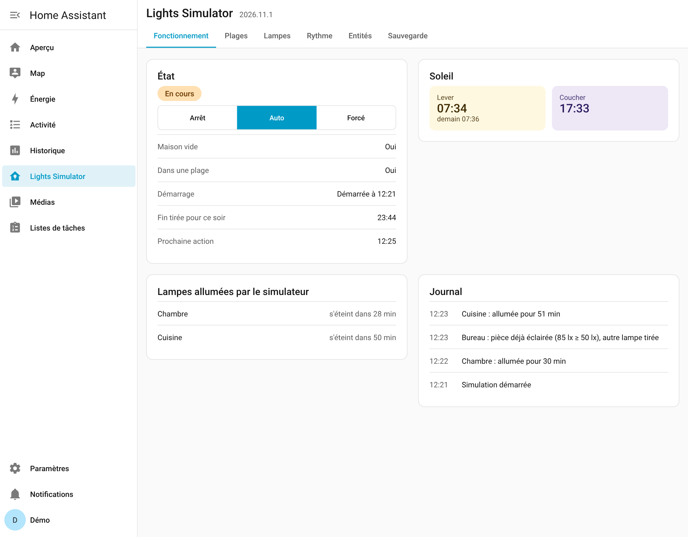
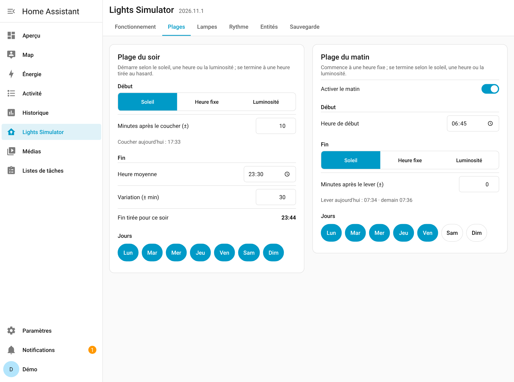
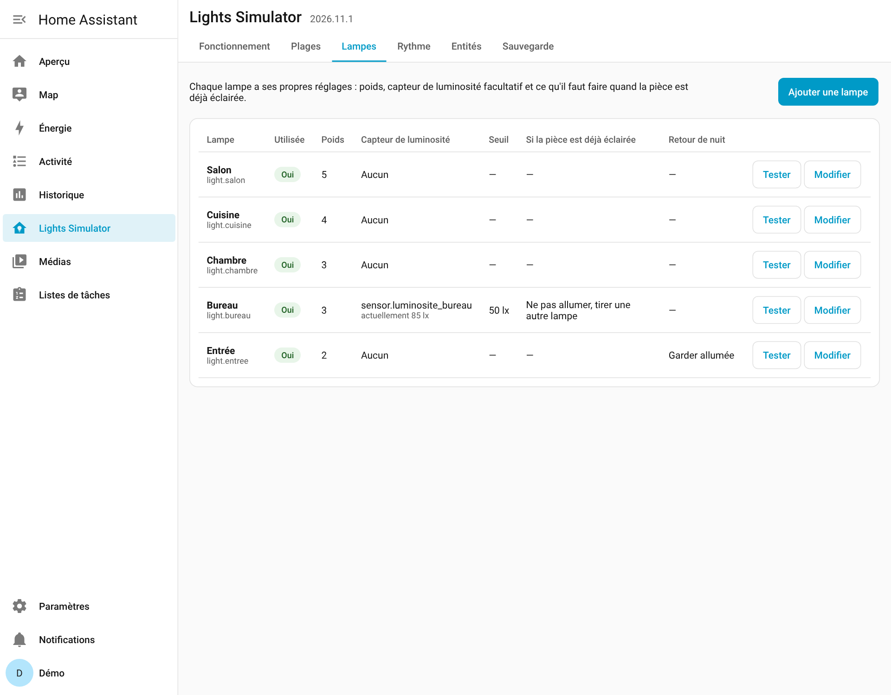
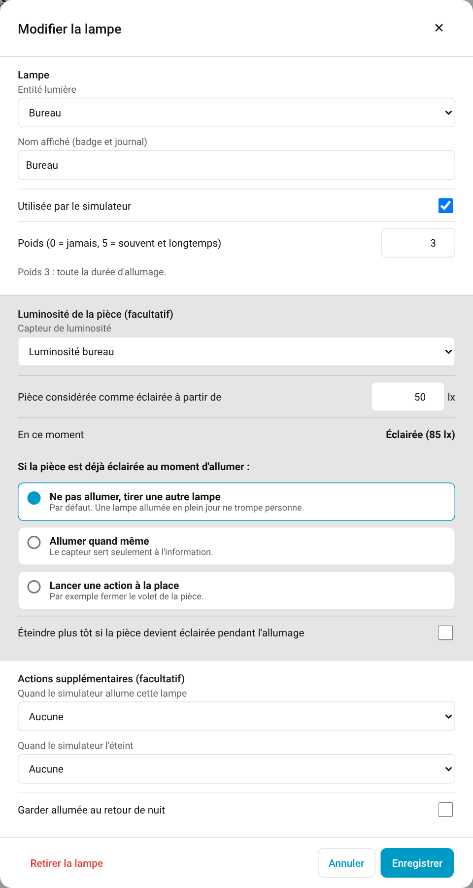
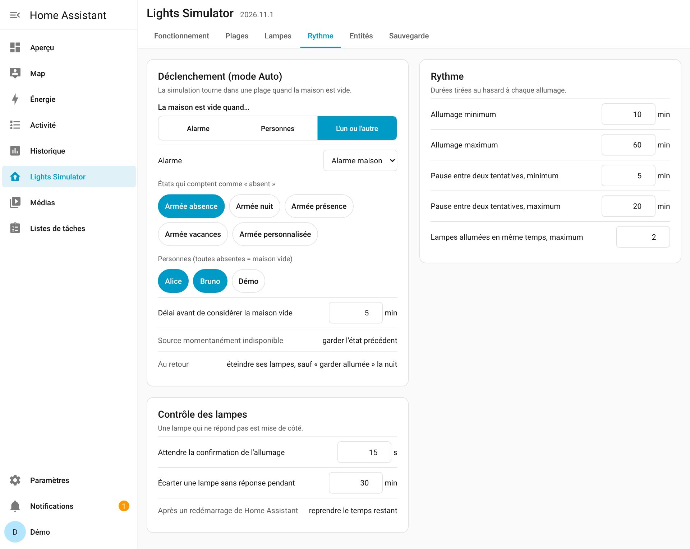
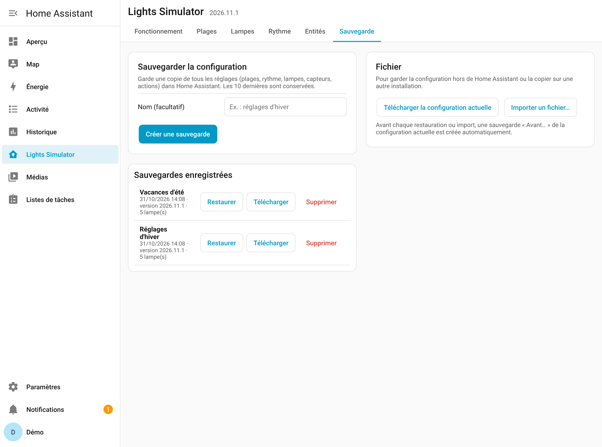
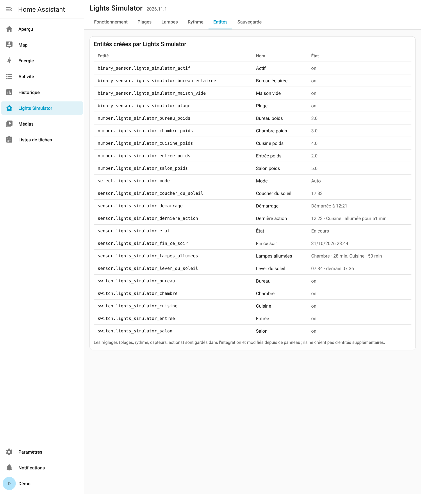
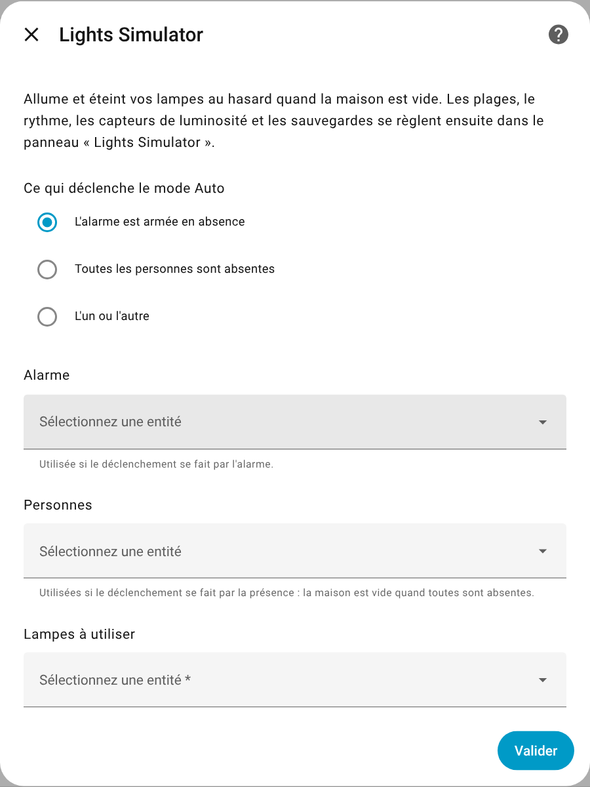
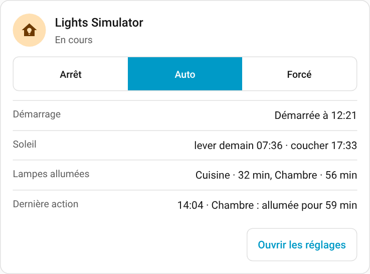
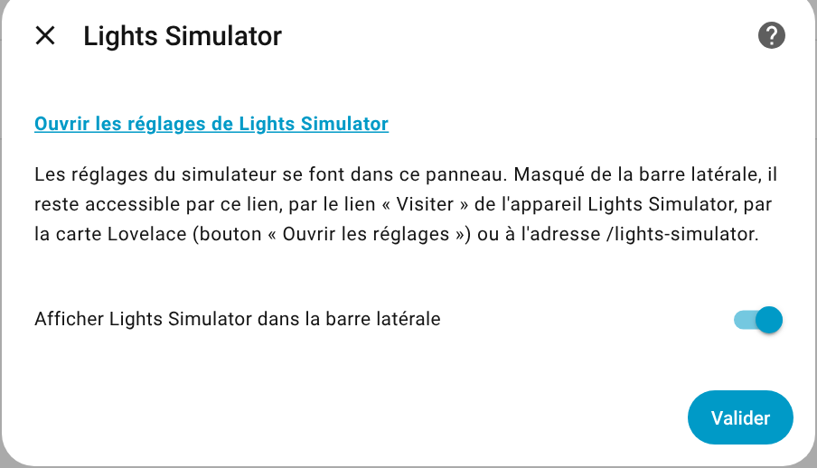

# Lights Simulator


🇫🇷 [Français](#français) · 🇬🇧 [English](#english)

[](https://github.com/akoonet-homeassistant/lights_simulator/releases)
[](LICENSE)
[](https://hacs.xyz)



## Français

Simulation de présence pour Home Assistant : quand la maison est vide, Lights Simulator allume et éteint vos lampes au hasard, le soir et éventuellement le matin, pour donner l'impression que quelqu'un est là.

### Fonctionnalités

- **Déclenchement** par l'alarme (états « absent » au choix), par l'absence de toutes les personnes choisies, ou par l'un ou l'autre, avec un délai avant de considérer la maison vide.
- **Modes** Arrêt, Auto et Forcé.
- **Plage du soir** : début au coucher du soleil ± minutes, à une heure fixe, ou quand la luminosité extérieure passe sous un seuil ; fin à une heure moyenne ± une variation tirée au hasard chaque soir ; jours à cocher.
- **Plage du matin** (facultative) : début à heure fixe ; fin au lever du soleil ± minutes, à une heure fixe, ou quand la luminosité dépasse un seuil ; jours à cocher.
- **Lampes pondérées** : un poids de 0 à 5 par lampe règle la fréquence et la durée d'allumage.
- **Capteur de luminosité par lampe** (facultatif) : si la pièce est déjà éclairée, ne pas allumer et tirer une autre lampe, allumer quand même, ou lancer une action (script, scène, automatisation) à la place ; option pour éteindre plus tôt si la pièce devient éclairée.
- **Actions facultatives** quand le simulateur allume ou éteint une lampe.
- **Fin de soirée progressive** : chaque lampe s'éteint 1 à 5 minutes avant la fin tirée, jamais d'extinction générale.
- **Retour de nuit** : au retour, les lampes du simulateur s'éteignent, sauf celles marquées « garder allumée » s'il fait nuit.
- **Contrôle des lampes** : une lampe qui ne confirme pas son allumage est écartée pendant un temps réglable.
- **Reprise après redémarrage** de Home Assistant : chaque lampe garde son heure d'extinction.
- **Sauvegarde de la configuration** : sauvegardes nommées dans Home Assistant (les 10 dernières), téléchargement et import d'un fichier JSON, copie de sécurité automatique avant chaque restauration.
- **Panneau latéral** « Lights Simulator », ouvert à tous les utilisateurs, qu'on peut retirer de la barre latérale, et **carte Lovelace** avec l'heure d'arrêt de chaque lampe allumée.

### Installation

#### Par HACS

[](https://my.home-assistant.io/redirect/hacs_repository/?owner=akoonet-homeassistant&repository=lights_simulator&category=integration)

1. Dans HACS, recherchez **Lights Simulator** et installez-le (ou utilisez le bouton ci-dessus).
2. Redémarrez Home Assistant.
3. *Paramètres → Appareils et services → Ajouter une intégration* → **Lights Simulator**.

#### Manuelle

Copiez `custom_components/lights_simulator` dans le dossier `custom_components` de votre configuration, redémarrez, puis ajoutez l'intégration.

### Configuration

L'assistant demande ce qui déclenche le mode Auto (alarme, personnes ou les deux) et les lampes à utiliser. S'il trouve un simulateur « fait main » à base d'entrées `simulateur_presence_*`, il propose d'en reprendre les réglages (plages, jours, rythme, poids, mode) sans rien modifier.

Tout le reste se règle dans le panneau **Lights Simulator** de la barre latérale. Tous les utilisateurs de Home Assistant peuvent changer les réglages, pas seulement les administrateurs.

| Onglet | Contenu |
|---|---|
| Fonctionnement | État, mode, démarrage prévu ou réel, fin tirée, lever et coucher du soleil, lampes allumées avec heure d'arrêt, affichage dans la barre latérale, journal |
| Plages | Plage du soir et du matin : sélecteur Soleil / Heure fixe / Luminosité, fin et variation, jours |
| Lampes | Une ligne par lampe ; fiche de lampe : poids, capteur de luminosité, seuil, comportement si la pièce est éclairée, actions, retour de nuit ; bouton Tester |
| Rythme | Déclenchement (alarme, personnes), durées d'allumage, pauses, lampes simultanées, contrôle des lampes |
| Entités | Les entités créées, avec leur état |
| Sauvegarde | Créer, restaurer, télécharger, supprimer une sauvegarde ; télécharger ou importer un fichier |

### Captures d'écran

| | |
|---|---|
| **Fonctionnement** — état, démarrage, soleil, lampes allumées, journal<br> | **Plages** — soir et matin, Soleil / Heure fixe / Luminosité<br> |
| **Lampes** — poids, capteurs, actions, test<br> | **Fiche d'une lampe** — capteur de luminosité et action<br> |
| **Rythme** — déclenchement alarme / personnes, durées, pauses<br> | **Sauvegarde** — sauvegardes nommées, fichier JSON<br> |
| **Entités** — toutes les entités créées<br> | **Installation** — assistant de configuration<br> |

**Carte Lovelace**



*Captures réalisées sur une installation de démonstration : toutes les entités sont fictives.*

### Entités

| Entité | Rôle |
|---|---|
| `select.lights_simulator_mode` | Mode : Arrêt, Auto, Forcé |
| `binary_sensor.lights_simulator_actif` | Simulation en cours |
| `binary_sensor.lights_simulator_maison_vide` | Maison vide (après le délai) |
| `binary_sensor.lights_simulator_plage` | Dans une plage (soir ou matin) |
| `sensor.lights_simulator_etat` | État lisible |
| `sensor.lights_simulator_demarrage` | Heure de démarrage réelle ou prévue |
| `sensor.lights_simulator_fin_ce_soir` | Fin tirée pour la soirée (horodatage) |
| `sensor.lights_simulator_lampes_allumees` | Lampes allumées et temps restant (attribut `lampes`) — pratique pour un badge |
| `sensor.lights_simulator_derniere_action` | Dernière ligne du journal (attribut `journal`) |
| `sensor.lights_simulator_lever_du_soleil` | Lever du jour (et du lendemain une fois passé) |
| `sensor.lights_simulator_coucher_du_soleil` | Coucher du jour (et du lendemain une fois passé) |
| `switch.lights_simulator_<lampe>` | Lampe utilisée par le simulateur |
| `number.lights_simulator_<lampe>_poids` | Poids de la lampe (0 à 5) |
| `binary_sensor.lights_simulator_<lampe>_eclairee` | Pièce déjà éclairée (seulement si un capteur est choisi) |

`<lampe>` est le nom de la lampe au moment où elle a été ajoutée (par exemple `salon`).

### Carte Lovelace

```yaml
type: custom:lights-simulator-card
```

La carte affiche le mode, l'état, le démarrage, le soleil, chaque lampe allumée avec son heure d'arrêt (« Cuisine — jusqu'à 15:04 · 38 min ») et la dernière action. Le bouton « Ouvrir les réglages » mène au panneau.

Options : `titre` (texte affiché), `prefixe` (si vous avez renommé les entités ; défaut `lights_simulator`). La carte est chargée automatiquement, aucune ressource à ajouter.

### Retirer Lights Simulator de la barre latérale

Désactivez **Afficher dans la barre latérale**, dans l'onglet *Fonctionnement* du panneau ou par *Paramètres → Appareils et services → Lights Simulator → Configurer*. Le panneau reste accessible :

- depuis *Paramètres → Appareils et services → Lights Simulator* : lien **Ouvrir les réglages de Lights Simulator** du bouton *Configurer*, ou lien **Visiter** de l'appareil Lights Simulator ;
- par le bouton « Ouvrir les réglages » de la carte Lovelace ;
- à l'adresse `/lights-simulator`.

Pour le réafficher dans la barre latérale, réactivez l'interrupteur dans le panneau ou dans *Configurer*.



### Passer d'un simulateur « fait main » à Lights Simulator

Lights Simulator ne modifie ni ne supprime vos entrées et automatisations existantes. Après l'installation, **désactivez vos anciennes automatisations de simulation** pour que deux simulateurs ne pilotent pas les mêmes lampes, puis mettez à jour vos tableaux de bord avec les nouvelles entités.

---

## English

Presence simulation for Home Assistant: while the house is empty, Lights Simulator randomly turns your lights on and off in the evening (and optionally in the morning), so it looks like someone is home.

### Features

- **Trigger**: alarm (choose which states count as "away"), every selected person away, or either one, with a delay before the house is considered empty.
- **Modes**: Off (Arrêt), Auto, Forced (Forcé).
- **Evening window**: starts at sunset ± minutes, at a fixed time, or when outdoor light drops below a threshold; ends at an average time ± a random variation drawn each evening; selectable days.
- **Morning window** (optional): starts at a fixed time; ends at sunrise ± minutes, at a fixed time, or when light rises above a threshold; selectable days.
- **Weighted lights**: a 0–5 weight per light sets how often and how long it is switched on.
- **Per-light illuminance sensor** (optional): if the room is already lit, skip it and pick another light, switch it on anyway, or run an action (script, scene, automation) instead; optional early switch-off when the room becomes lit.
- **Optional actions** when the simulator switches a light on or off.
- **Gradual end of evening**: each light goes off 1 to 5 minutes before the drawn end time, never all at once.
- **Coming home at night**: the simulator's lights go off, except those marked "keep on" when it is dark.
- **Light check**: a light that does not confirm it switched on is set aside for a configurable time.
- **Resume after a Home Assistant restart**: each light keeps its switch-off time.
- **Configuration backup**: named backups stored in Home Assistant (last 10), JSON file download and import, automatic safety copy before every restore.
- **Sidebar panel** "Lights Simulator", open to every user and removable from the sidebar, and **Lovelace card** showing when each lit light will switch off.

### Installation

**HACS**: search for **Lights Simulator** and install it, or use this button: [](https://my.home-assistant.io/redirect/hacs_repository/?owner=akoonet-homeassistant&repository=lights_simulator&category=integration) Restart Home Assistant, then *Settings → Devices & services → Add integration* → **Lights Simulator**.

**Manual**: copy `custom_components/lights_simulator` into your `custom_components` folder, restart, then add the integration.

### Configuration

The setup flow asks what triggers Auto mode (alarm, people or either) and which lights to use. If it finds a hand-made simulator built from `simulateur_presence_*` helpers, it offers to import its settings (windows, days, rhythm, weights, mode) without changing them.

Everything else is set in the **Lights Simulator** sidebar panel. Every Home Assistant user can change the settings, not only administrators. Tabs: *Fonctionnement* (status, mode, start time, drawn end, sunrise and sunset, lit lights with switch-off time, sidebar display, log), *Plages* (evening and morning windows), *Lampes* (per-light settings and Test button), *Rythme* (trigger, durations, pauses, simultaneous lights, light check), *Entités* (created entities), *Sauvegarde* (backups and files). The interface is in French.

### Screenshots

The interface is in French. Screenshots are in the French section above: [Fonctionnement](docs/screenshots/fonctionnement.png) (status), [Plages](docs/screenshots/plages.png) (windows), [Lampes](docs/screenshots/lampes.png) (lights), [lamp form](docs/screenshots/lampe.png), [Rythme](docs/screenshots/rythme.png) (trigger and rhythm), [Sauvegarde](docs/screenshots/sauvegarde.png) (backup), [Entités](docs/screenshots/entites.png) (entities), [setup flow](docs/screenshots/installation.png), [Configure dialog](docs/screenshots/configurer.png), [Lovelace card](docs/screenshots/carte.png). They were taken on a demo installation; all entities are fictitious.

### Entities

Same entities as listed in the French section above: `select.lights_simulator_mode`, `binary_sensor.lights_simulator_actif` (running), `binary_sensor.lights_simulator_maison_vide` (house empty), `binary_sensor.lights_simulator_plage` (inside a window), `sensor.lights_simulator_etat` (status), `sensor.lights_simulator_demarrage` (start time), `sensor.lights_simulator_fin_ce_soir` (drawn end, timestamp), `sensor.lights_simulator_lampes_allumees` (lit lights and remaining time), `sensor.lights_simulator_derniere_action` (last log line), `sensor.lights_simulator_lever_du_soleil` (sunrise), `sensor.lights_simulator_coucher_du_soleil` (sunset), and per light `switch.lights_simulator_<light>` (used), `number.lights_simulator_<light>_poids` (weight), `binary_sensor.lights_simulator_<light>_eclairee` (room lit, only with a sensor).

### Lovelace card

```yaml
type: custom:lights-simulator-card
```

Options: `titre` (title), `prefixe` (if you renamed the entities; default `lights_simulator`). The card is loaded automatically, no resource to add.

The card shows the mode, status, start time, sun, each lit light with its switch-off time ("Cuisine — jusqu'à 15:04 · 38 min") and the last action. The "Ouvrir les réglages" button opens the panel.

### Removing Lights Simulator from the sidebar

Turn off **Afficher dans la barre latérale** (show in sidebar) in the panel's *Fonctionnement* tab or in *Settings → Devices & services → Lights Simulator → Configure*. The panel stays reachable:

- from *Settings → Devices & services → Lights Simulator*: the **Open Lights Simulator settings** link in the *Configure* dialog, or the **Visit** link of the Lights Simulator device;
- from the Lovelace card's "Ouvrir les réglages" button;
- at `/lights-simulator`.

To show it in the sidebar again, turn the switch back on in the panel or in *Configure*.

### Moving from a hand-made simulator

Lights Simulator never changes or removes your existing helpers and automations. After installing it, **disable your old simulation automations** so two simulators do not drive the same lights.

---

## Licence / License

MIT
Auteur / Author : [@JeromeRoseau](https://github.com/JeromeRoseau).
